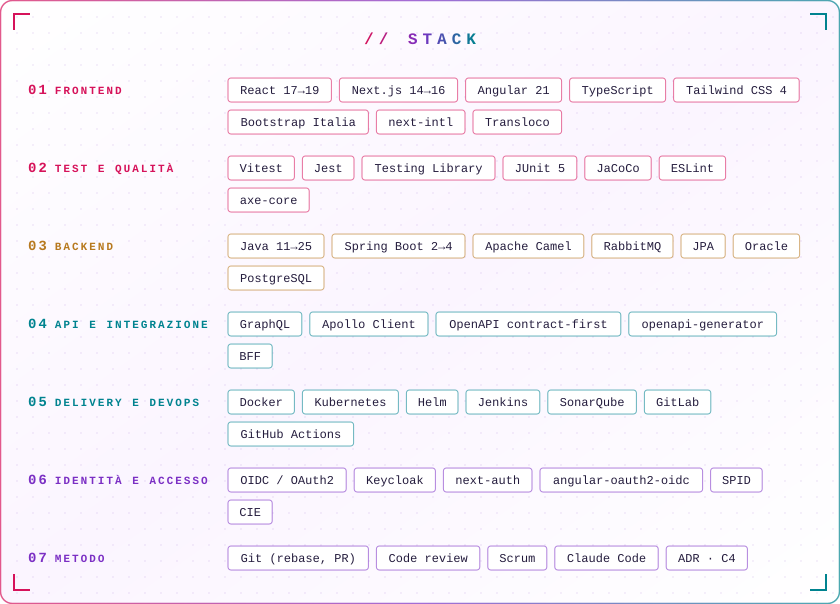

<!-- KXOS — GitHub Profile README (italiano) · versione principale: README.md -->

<a href="https://kxos.github.io"><picture><source media="(prefers-color-scheme: dark)" srcset="./assets/header.svg"><source media="(prefers-color-scheme: light)" srcset="./assets/header-light.svg"></picture></a>

<a href="https://kxos.github.io"><picture><source media="(prefers-color-scheme: dark)" srcset="./assets/tagline-it.svg"><source media="(prefers-color-scheme: light)" srcset="./assets/tagline-it-light.svg"></picture></a>

<a href="https://kxos.github.io"><picture><source media="(prefers-color-scheme: dark)" srcset="./assets/badge-portfolio.svg"><source media="(prefers-color-scheme: light)" srcset="./assets/badge-portfolio-light.svg"></picture></a>&nbsp;&nbsp;
<a href="https://www.linkedin.com/in/vito-iannone-3841801a4/"><picture><source media="(prefers-color-scheme: dark)" srcset="./assets/badge-linkedin.svg"><source media="(prefers-color-scheme: light)" srcset="./assets/badge-linkedin-light.svg"></picture></a>

[English](./README.md) · **Italiano**

## Chi sono

Realizzo portali web e single-page app per servizi digitali su larga scala. Dal 2022 sono sviluppatore full-stack e Front-End Team Lead in **DXC Technology**: curo code review, qualità del codice e scelte di architettura sul frontend.

Il mio baricentro è il frontend, con **React, Next.js e Angular**, sempre in TypeScript. Dietro lavoro con **BFF Spring Boot**, **OpenAPI** contract-first, **GraphQL** e autenticazione OIDC con **Keycloak**, SPID e CIE. Sviluppo anche con agenti AI (Claude Code) e ne rivedo il lavoro come qualsiasi altra pull request.

<a href="https://kxos.github.io/#skills"><picture><source media="(prefers-color-scheme: dark)" srcset="./assets/stack-it.svg"><source media="(prefers-color-scheme: light)" srcset="./assets/stack-it-light.svg"></picture></a>

## Progetti in evidenza

**Wallet digitale per i cittadini** · 2026 
SPA Angular 21 e BFF Spring Boot 4 / Java 25, costruiti contract-first su OpenAPI 3.1. Il client API è generato dal contratto e una regola ESLint vieta le chiamate HTTP scritte a mano. Login CIE via OIDC, errori problem+json con correlation id, probe Kubernetes, controlli di accessibilità con axe-core.

**Portali per un gateway di interoperabilità** · 2025–2026 
Quattro portali Next.js 16 / React 19 con Tailwind CSS 4, Apollo GraphQL, login Keycloak (SPID), next-intl e Swagger UI. Immagini Docker non-root costruite da Jenkins su Kubernetes, con BuildKit e SonarQube.

**Osservatorio sul trasporto pubblico locale** · 2024–2025 
Il mio progetto principale (~880 commit): portale riservato in Next.js 14 con Apollo GraphQL, next-auth + Keycloak, mappe Leaflet e dashboard Chart.js, configurato a runtime tramite l'entrypoint Docker, più la versione pubblica.

**SPA per pratiche amministrative** · 2023–2024 
Cinque SPA React + TypeScript su un archetipo comune, con client RxJS generati da OpenAPI, react-hook-form, TanStack Table, Jest + Testing Library e build Docker multi-stage con stage SonarQube.

## Open source e attività

<a href="https://github.com/Kxos/kxos.github.io"><picture><source media="(prefers-color-scheme: dark)" srcset="https://github-readme-stats.vercel.app/api/pin/?username=Kxos&repo=kxos.github.io&hide_border=true&bg_color=04020e&title_color=ff2d78&icon_color=00f5ff&text_color=9b93c8&cache_seconds=1800"><source media="(prefers-color-scheme: light)" srcset="https://github-readme-stats.vercel.app/api/pin/?username=Kxos&repo=kxos.github.io&hide_border=false&border_color=e9dcf7&bg_color=ffffff&title_color=d6125a&icon_color=00838f&text_color=5b5680&cache_seconds=1800"></picture></a>

<a href="https://github.com/Kxos"><picture><source media="(prefers-color-scheme: dark)" srcset="https://streak-stats.demolab.com?user=Kxos&card_width=815&card_height=195&background=04020e&ring=ff2d78&fire=b44fff&currStreakLabel=00f5ff&sideLabels=9b93c8&dates=9b93c8&stroke=160f30&currStreakNum=f0ecff&sideNums=f0ecff&border=160f30&hide_border=true"><source media="(prefers-color-scheme: light)" srcset="https://streak-stats.demolab.com?user=Kxos&card_width=815&card_height=195&background=ffffff&ring=d6125a&fire=7b2fc4&currStreakLabel=00838f&sideLabels=5b5680&dates=5b5680&stroke=e9dcf7&currStreakNum=241c3d&sideNums=241c3d&border=e9dcf7&hide_border=false"></picture></a>

<a href="https://github.com/Kxos"><picture><source media="(prefers-color-scheme: dark)" srcset="https://github-readme-stats.vercel.app/api?username=Kxos&show_icons=true&count_private=true&hide_rank=true&hide=stars&show=prs_merged,prs_merged_percentage&card_width=480&bg_color=04020e&title_color=ff2d78&icon_color=00f5ff&text_color=9b93c8&ring_color=b44fff&border_color=160f30&hide_border=true&cache_seconds=1800"><source media="(prefers-color-scheme: light)" srcset="https://github-readme-stats.vercel.app/api?username=Kxos&show_icons=true&count_private=true&hide_rank=true&hide=stars&show=prs_merged,prs_merged_percentage&card_width=480&bg_color=ffffff&title_color=d6125a&icon_color=00838f&text_color=5b5680&ring_color=7b2fc4&border_color=e9dcf7&hide_border=false&cache_seconds=1800"></picture></a>
<a href="https://github.com/Kxos"><picture><source media="(prefers-color-scheme: dark)" srcset="https://github-readme-stats.vercel.app/api/top-langs/?username=Kxos&layout=compact&langs_count=6&card_width=280&bg_color=04020e&title_color=ff2d78&text_color=9b93c8&border_color=160f30&hide_border=true&cache_seconds=1800"><source media="(prefers-color-scheme: light)" srcset="https://github-readme-stats.vercel.app/api/top-langs/?username=Kxos&layout=compact&langs_count=6&card_width=280&bg_color=ffffff&title_color=d6125a&text_color=5b5680&border_color=e9dcf7&hide_border=false&cache_seconds=1800"></picture></a>

<a href="https://kxos.github.io"><picture><source media="(prefers-color-scheme: dark)" srcset="./assets/footer.svg"><source media="(prefers-color-scheme: light)" srcset="./assets/footer-light.svg"></picture></a>

