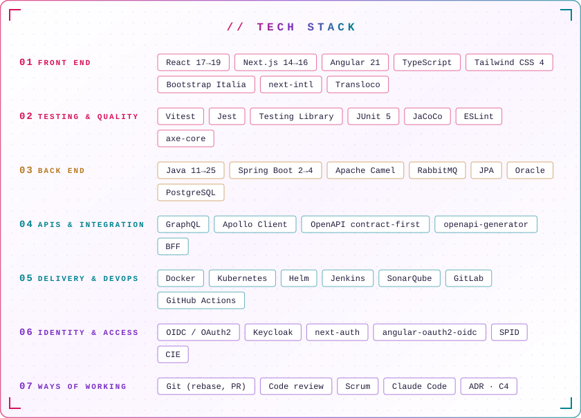

<!-- KXOS — GitHub Profile README · repo: Kxos/Kxos · Italian version: README.it.md -->

<a href="https://kxos.github.io"><picture><source media="(prefers-color-scheme: dark)" srcset="./assets/header.svg"><source media="(prefers-color-scheme: light)" srcset="./assets/header-light.svg"></picture></a>

<a href="https://kxos.github.io"><picture><source media="(prefers-color-scheme: dark)" srcset="./assets/tagline.svg"><source media="(prefers-color-scheme: light)" srcset="./assets/tagline-light.svg"></picture></a>

<a href="https://kxos.github.io"><picture><source media="(prefers-color-scheme: dark)" srcset="./assets/badge-portfolio.svg"><source media="(prefers-color-scheme: light)" srcset="./assets/badge-portfolio-light.svg"></picture></a>&nbsp;&nbsp;
<a href="https://www.linkedin.com/in/vito-iannone-3841801a4/"><picture><source media="(prefers-color-scheme: dark)" srcset="./assets/badge-linkedin.svg"><source media="(prefers-color-scheme: light)" srcset="./assets/badge-linkedin-light.svg"></picture></a>

**English** · [Italiano](./README.it.md)

## About

I build web portals and single-page apps for large-scale digital services. Since 2022 I've been a full-stack developer and front-end team lead at **DXC Technology**, responsible for code review, code quality and front-end architecture decisions.

My focus is the front end: **React, Next.js and Angular**, always in TypeScript. Behind it I work with **Spring Boot BFFs**, contract-first **OpenAPI**, **GraphQL** and OIDC sign-in through **Keycloak**, SPID and CIE. I also build with AI coding agents (Claude Code) and review their output like any other pull request.

<a href="https://kxos.github.io/#skills"><picture><source media="(prefers-color-scheme: dark)" srcset="./assets/stack.svg"><source media="(prefers-color-scheme: light)" srcset="./assets/stack-light.svg"></picture></a>

## Selected work

**Digital wallet for citizens** · 2026 
Angular 21 SPA and Spring Boot 4 / Java 25 BFF, built contract-first on OpenAPI 3.1. The API client is generated from the contract and an ESLint rule forbids hand-written HTTP calls. CIE sign-in over OIDC, problem+json errors with correlation IDs, Kubernetes probes, accessibility checks with axe-core.

**Interoperability gateway portals** · 2025–2026 
Four Next.js 16 / React 19 portals with Tailwind CSS 4, Apollo GraphQL, Keycloak sign-in (SPID), next-intl and Swagger UI. Non-root Docker images built by Jenkins on Kubernetes, with BuildKit and SonarQube.

**Local public transport observatory** · 2024–2025 
My main project (~880 commits): a restricted Next.js 14 portal with Apollo GraphQL, next-auth + Keycloak, Leaflet maps and Chart.js dashboards, configured at runtime through the Docker entrypoint, plus its public counterpart.

**SPAs for administrative procedures** · 2023–2024 
Five React + TypeScript SPAs on a shared archetype, with OpenAPI-generated RxJS clients, react-hook-form, TanStack Table, Jest + Testing Library and multi-stage Docker builds with a SonarQube stage.

## Open source & activity

<a href="https://github.com/Kxos/kxos.github.io"><picture><source media="(prefers-color-scheme: dark)" srcset="https://github-readme-stats.vercel.app/api/pin/?username=Kxos&repo=kxos.github.io&hide_border=true&bg_color=04020e&title_color=ff2d78&icon_color=00f5ff&text_color=9b93c8&cache_seconds=1800"><source media="(prefers-color-scheme: light)" srcset="https://github-readme-stats.vercel.app/api/pin/?username=Kxos&repo=kxos.github.io&hide_border=false&border_color=e9dcf7&bg_color=ffffff&title_color=d6125a&icon_color=00838f&text_color=5b5680&cache_seconds=1800"></picture></a>

<a href="https://github.com/Kxos"><picture><source media="(prefers-color-scheme: dark)" srcset="https://streak-stats.demolab.com?user=Kxos&card_width=815&card_height=195&background=04020e&ring=ff2d78&fire=b44fff&currStreakLabel=00f5ff&sideLabels=9b93c8&dates=9b93c8&stroke=160f30&currStreakNum=f0ecff&sideNums=f0ecff&border=160f30&hide_border=true"><source media="(prefers-color-scheme: light)" srcset="https://streak-stats.demolab.com?user=Kxos&card_width=815&card_height=195&background=ffffff&ring=d6125a&fire=7b2fc4&currStreakLabel=00838f&sideLabels=5b5680&dates=5b5680&stroke=e9dcf7&currStreakNum=241c3d&sideNums=241c3d&border=e9dcf7&hide_border=false"></picture></a>

<a href="https://github.com/Kxos"><picture><source media="(prefers-color-scheme: dark)" srcset="https://github-readme-stats.vercel.app/api?username=Kxos&show_icons=true&count_private=true&hide_rank=true&hide=stars&show=prs_merged,prs_merged_percentage&card_width=480&bg_color=04020e&title_color=ff2d78&icon_color=00f5ff&text_color=9b93c8&ring_color=b44fff&border_color=160f30&hide_border=true&cache_seconds=1800"><source media="(prefers-color-scheme: light)" srcset="https://github-readme-stats.vercel.app/api?username=Kxos&show_icons=true&count_private=true&hide_rank=true&hide=stars&show=prs_merged,prs_merged_percentage&card_width=480&bg_color=ffffff&title_color=d6125a&icon_color=00838f&text_color=5b5680&ring_color=7b2fc4&border_color=e9dcf7&hide_border=false&cache_seconds=1800"></picture></a>
<a href="https://github.com/Kxos"><picture><source media="(prefers-color-scheme: dark)" srcset="https://github-readme-stats.vercel.app/api/top-langs/?username=Kxos&layout=compact&langs_count=6&card_width=280&bg_color=04020e&title_color=ff2d78&text_color=9b93c8&border_color=160f30&hide_border=true&cache_seconds=1800"><source media="(prefers-color-scheme: light)" srcset="https://github-readme-stats.vercel.app/api/top-langs/?username=Kxos&layout=compact&langs_count=6&card_width=280&bg_color=ffffff&title_color=d6125a&text_color=5b5680&border_color=e9dcf7&hide_border=false&cache_seconds=1800"></picture></a>

<a href="https://kxos.github.io"><picture><source media="(prefers-color-scheme: dark)" srcset="./assets/footer.svg"><source media="(prefers-color-scheme: light)" srcset="./assets/footer-light.svg"></picture></a>

